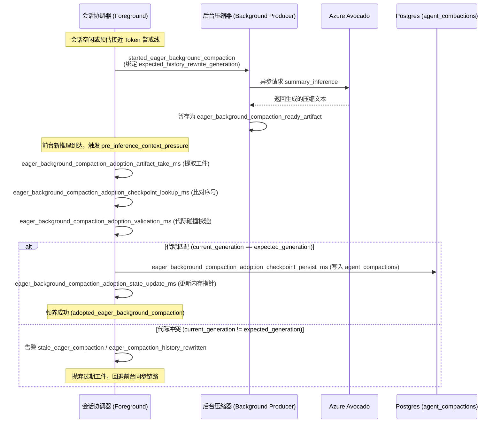

# 上下文压缩与后台急切压缩机制（课题 B）

> 来源：`hatch` 核心引擎二进制（`/opt/hatch/bin/hatch`）符号表、内嵌 SQL、运行时日志、官方权威数据字典（`assets/muse-assets/skills/muse_db/references/schema.md`）
> 定位：**会话长程记忆与上下文工程底层实现** —— 解析多轮交互中上下文超限时的压缩、快照防护、急切后台预生成与代际隔离机制
> 系列：[self-improvement-synthesis.md 🔒](/roadmap#batch4) · [bandit-and-data-layer.md 🔒](/roadmap#batch4) · [browser-and-checkout.md 🔒](/roadmap#batch3) · [self-improvement-deep-dive.md 🔒](/roadmap#batch4)
> 证据：SQL 原文逐字；系统提示词模板逐字；符号表 demangled 路径与遥测指标逐字

---

## 0. 核心定位与为什么重要

在长周期复杂任务（多轮工具调用、Browser 自动化页面抓取、PDF 解析、代码生成）中，LLM 的上下文窗口会迅速逼近上限。

传统方案通常简单粗暴：丢弃最早的 N 轮历史（Sliding Window）导致早期指令与关键信息丢失，或者在主线程阻塞调用大模型生成压缩摘要导致数秒以上的卡顿（Time-To-First-Token, TTFT 恶化）。

Muse 运行时（`hatch`）通过独立的 `hatch-compaction` crate 与运行时会话状态机，构建了一套**结合记忆冲刷（Memory Flush）、双模型协同、急切后台生成（Eager Background Compaction）与代际安全隔离（Generation Fencing）**的工业级压缩体系：

1. **信息无损兜底**：在压缩对话历史前，必须先唤醒记忆冲刷流程（Memory Flush），将即将丢弃的历史有效实体提取沉淀到独立持久化层，避免信息蒸发。
2. **零感知时延（Sub-millisecond Adoption）**：后台预判上下文压力，空闲期异步派发专用压缩模型生成摘要（Producer）；前台阻塞点只需执行微秒级验证与原子领养（Adopt），将耗时消除于无形。
3. **因果与代际防击穿（Generation Fencing）**：利用 `expected_history_rewrite_generation` 精准捕获后台生成期间由用户新消息或工具异步回调引发的历史变动，彻底杜绝陈旧摘要污染上下文。

---

## 1. 架构分解与源码模块分布

二进制反编译与符号表提取显示，压缩机制在工程上被划分为核心算法库、会话运行时、数据持久层三个清晰层次：

```
hatch-engine/
├── crates/hatch-compaction/                       ← 底层核心压缩算法库
│   └── src/
│       ├── transcript.rs                          ← 历史转录本投影视图解析
│       ├── transcript/retained_history.rs         ← 保留历史判定（保留窗口与 Pinned 边界）
│       ├── transcript/summary_input.rs            ← 摘要模型 Prompt 装配与多语言约束
│       └── quality.rs                             ← 压缩产物质量与幻觉校验
├── crates/hatch-agent/                            ← 智能体业务接入层
│   └── src/
│       ├── compact/                               ← 上下文压缩特化模块族
│       │   ├── eager.rs                           ← 急切后台预压缩状态机与跑道判定
│       │   ├── native_prompt.rs                   ← 系统提示词注入模板装配
│       │   ├── retained_context.rs                ← 驻留 live 文件隔离与有效上下文维护
│       │   └── todo_snapshot.rs                   ← 压缩前后待办事项（Todo）快照存取
│       └── session/impl_session/
│           ├── eager_compaction.rs                ← 会话级后台 Producer / Adopt 流程编排
│           ├── history_persistence/
│           │   └── context_pressure.rs            ← 历史持久化与上下文压力评估
│           ├── voice_compaction_cache.rs          ← 语音会话专用极速增量缓存
│           └── logging/compaction.rs              ← 微秒级遥测与打点
└── crates/hatch-db/                               ← 数据库持久化层
    └── src/agent_state/agent_compactions.rs       ← agent_compactions 表事务控制与投影裁剪
```

### 1.1 核心职责分工

| 模块 | 核心职责 | 关键数据结构 / 符号 |
|---|---|---|
| `transcript.rs` | 遍历会话事件流，依据 `seq` 和 `checkpoint_seq` 切割可压缩区与不可压缩区 | `SessionTranscriptEntry::CompactionCheckpoint` |
| `retained_history.rs` | 计算 `first_kept_seq`，锁定保留未压缩的历史轮次（保障最近轮次的交互连贯性） | `details_json -> 'replacement_history_seq'` |
| `summary_input.rs` | 组装送入压缩模型的 prompt，强行注入实体保留（Verbatim）与目标区域语言约束 | `summary_input_prompt` |
| `quality.rs` | 压缩产物审计，检查是否发生文本为空、反常缩减比率或关键实体蒸发 | `CompactionQuality`, `stream_ended_without_done` |
| `compact/eager.rs` | 后台急切压缩触发决策与调度逻辑，管理跑道与软上限判断 | `under_soft_limit`, `needs_user_runway` |
| `compact/native_prompt.rs` | 格式化压缩完成后主模型顶部的引导提示词（系统告知文本） | `<summary>{{summary}}</summary>` 注入 |
| `compact/retained_context.rs` | 驻留上下文保护，识别豁免 `AGENTS.md`、`SOUL.md` 等常驻文件 | `live current copies` 隔离 |
| `compact/todo_snapshot.rs` | 压缩跨边界时的待办任务状态暂存与恢复 | `runtime.todo_snapshot` 存取 |
| `eager_compaction.rs` | 协调前台会话与后台 Producer，执行代际校验与原子领养 | `eager_background_compaction_*` |
| `voice_compaction_cache.rs` | 针对实时语音（S2S）的高频低延迟特性，复用中间压缩向量与文本缓存 | `VoiceCompactionCache` |

---

## 2. 数据库设计与持久化水位线（权威 Schema 交叉验证）

在持久化层，Muse 经历了从 v1 到 v2 的架构演进，所有字段均与权威数据字典 `assets/muse-assets/skills/muse_db/references/schema.md` 逐字对齐。

### 2.1 生产主表：`agent.agent_compactions` (v2)

权威表结构（逐字）：

```sql
CREATE TABLE agent.agent_compactions (
  id                       bigint NOT NULL DEFAULT nextval('agent.agent_compactions_id_seq'::regclass),
  agent_id                 text NOT NULL,     -- 软引用 -> agent.agents.agent_id
  summary                  text NOT NULL,     -- 压缩生成的紧凑历史摘要
  first_kept_seq           bigint,            -- 首个保留未压缩的消息序号
  checkpoint_seq           bigint,            -- 快照截断序号（<= checkpoint_seq 的历史被摘要置换）
  tokens_before            bigint,            -- 压缩前上下文 Token 数
  tokens_after             bigint,            -- 压缩后摘要 Token 数
  trigger                  text NOT NULL,     -- 触发原因（manual, threshold, model_switch, context_reset）
  will_retry               boolean NOT NULL DEFAULT false,
  created_at               bigint NOT NULL,   -- 毫秒级 Unix 时间戳
  has_replacement_history  boolean NOT NULL DEFAULT false,
  details_json             text               -- ⚠️ 敏感字段（含跨快照保留的内部推理与 replacement_history_seq）
);
```

> **安全隔离说明（官方 Schema 注释逐字）**：
> *"Redacted. The compaction detail payload is withheld because it carries the model reasoning retained across the checkpoint. Queries against this table run against the security-barrier view `inspection.agent_compactions`, which projects the columns listed below. Withheld columns: `details_json`."*
> 
> `details_json` 存放着模型内部思考链（Thinking Chain）跨越压缩边界时的持久化表征。出于安全与隐私防泄漏考量，外部透视视图 `inspection.agent_compactions` 对此字段做了严格的 security barrier 拦截。

### 2.2 遗留版本：`agent.compactions` (v1)

早期使用的单向截断表：

```sql
CREATE TABLE agent.compactions (
  compaction_id                   bigint NOT NULL DEFAULT nextval('agent.compactions_compaction_id_seq'::regclass),
  agent_id                        text NOT NULL,
  checkpoint_context_item_id      bigint REFERENCES agent.context_items(context_item_id),
  replacement_history_first_seq   integer,
  replacement_history_last_seq    integer,
  created_at                      timestamp with time zone NOT NULL DEFAULT now(),
  summary_text                    text NOT NULL
);
```

### 2.3 上下文投影裁剪与双重水位线 SQL

模型在每次执行推理装配系统 Prompt 时，并不会把数据库内全部的 `context_items` 读取出来，而是通过 `context_item_resume_projection` 执行投影视图裁剪。

二进制中提取到的真实 SQL 揭示了**双重水位线（Double Floor Filtering）**的数学逻辑：

```sql
-- 1. 计算会话当前的有效历史过滤边界
SELECT
  GREATEST(
    (SELECT COALESCE(MAX(seq), -1) FROM context_items WHERE agent_id = $1),
    (SELECT COALESCE(MAX(seq), -1) FROM context_item_resume_projection WHERE agent_id = $1)
  ) AS max_item_seq,
  COALESCE((SELECT prompt_floor_seq FROM agents WHERE id = $1), -1)
    AS prompt_floor_seq,
  (SELECT COALESCE(MAX(checkpoint_seq), -1)
     FROM agent_compactions
    WHERE agent_id = $1
      AND checkpoint_seq IS NOT NULL
      AND has_replacement_history)
    AS checkpoint_seq;

-- 2. 投影视图清理：裁剪已被压缩快照覆盖或低于 prompt_floor 的陈旧行
DELETE FROM context_item_resume_projection projection
WHERE projection.agent_id = $1
  AND NOT (projection.seq = ANY($2))
  AND projection.seq > GREATEST(
    COALESCE((SELECT prompt_floor_seq FROM agents WHERE id = $1), -1),
    COALESCE((SELECT checkpoint_seq FROM agent_compactions
              WHERE agent_id = $1 AND has_replacement_history
              ORDER BY id DESC LIMIT 1), -1)
  )
  AND NOT EXISTS (
    SELECT 1 FROM runtime.events e
    WHERE e.message_id = projection.provenance_json::jsonb ->> 'message_id'
      AND COALESCE(NULLIF(TRIM(e.agent_id), ''), e.parent_agent_id) <> projection.agent_id
      AND e.visibility = 'public' AND e.transcript_surface = 'main_chat'
  );
```

**水位线生效逻辑**：
- `prompt_floor_seq`：人工或系统硬性划定的保底地板（例如清屏、分支重置）。
- `checkpoint_seq`：最近一次生效压缩截断点。
- 真正送入 Prompt 的活跃上下文必须严格满足：`seq > GREATEST(prompt_floor_seq, checkpoint_seq)`。

---

## 3. 专用模型与 Prompt 逐字装配

`hatch` 没有复用昂贵且通用的大语言模型来做压缩，而是配备了专职模型流水线。

### 3.1 专用模型架构与 Gatekeeper 路由

二进制中注册的压缩专用端点：

| 模型端点 Identifier | 显示 Label | 核心职责 | Gatekeeper 路由开关 |
|---|---|---|---|
| `azure/avocado-compaction-v1` | `"Compaction"` | 提取历史转录本，生成结构化延续摘要 | 默认常驻专用路由 |
| `azure/avocado-memory-flush-v1` | `"Memory flush"` | 压缩前抓取即将被废弃上下文中的事实记忆 | `hatch_compaction_memory_flush_main_model`（关时使用 Avocado 专用端点，开时降级回主模型） |

### 3.2 压缩请求的 Prompt 装配规范（逐字原文）

在 `hatch-compaction/src/transcript/summary_input.rs` 中，系统要求压缩模型输出高度客观、结构化且保真的结果：

> **给压缩模型的指令 Prompt（逐字原文）**：
> ```
> Above is the previous conversation history. Create a context checkpoint summary for yourself so you can continue this conversation after compaction.
> Be concise, structured, and focused on continuing the work. Reply back with the compaction summary.
> ```

同时伴随严格的跨语言与命名实体注入准则：
- **语言保真**：`Write newly authored user-visible natural-language content in [locale].`
- **字面量锁定**：`Preserve identifiers, paths, URLs, filenames, proper nouns, and quoted user or external text verbatim.`（严禁擅自改写、翻译或概括路径、标识符与外链）。

### 3.3 压缩完成后注入主模型的系统提示词包装（逐字原文）

压缩完成后，生成的 `summary` 会作为首条历史块替换旧上下文。主模型在推理时会收到如下由系统自动拼接的系统通知：

> **主模型上下文首部注入文案（逐字原文）**：
> ```markdown
> Your conversation grew past its size limit and was compacted: earlier turns were summarized, and the summary below now stands at the beginning of your context in their place.
> 
> Compaction can reset which deferred tool namespaces are loaded.
> 
> Standing context files shown elsewhere in this prompt, such as AGENTS.md, SOUL.md, TOOLS.md, IDENTITY.md, USER.md, MEMORY.md, and HEARTBEAT.md, are live current copies and are not part of the compacted history.
> 
> <summary>
> {{summary}}
> </summary>
> ```

**三条关键工程保障**：
1. **工具命名空间重置**：明文告诫主模型压缩可能重置延迟加载的工具（deferred tool namespaces），需要根据当前任务重新按需声明。
2. **常驻系统文件隔离**：明确指出 `AGENTS.md`, `SOUL.md`, `TOOLS.md`, `IDENTITY.md`, `USER.md`, `MEMORY.md`, `HEARTBEAT.md` 永远保持 live 状态，绝不属于被压缩的陈旧历史，杜绝模型产生记忆混淆。
3. **标签隔离**：通过 `<summary>` 标签将压缩文本结构化封闭，防止 Prompt Injection 与提示词混淆。

---

## 4. ⭐ 急切后台压缩机制（Eager Background Compaction）

急切后台压缩是 `hatch` 在上下文工程中最具特色的低延迟优化机制。

### 4.1 传统前台同步压缩 vs 后台急切压缩

```
[传统前台同步压缩]
用户输入 ──> 上下文压力检测 ──> [阻塞] Memory Flush (1.2s) ──> [阻塞] Avocado Summary (2.5s) ──> [阻塞] DB 落库 ──> 开始主模型推理 (TTFT 累加 > 4s)

[Hatch 急切后台预压缩]
空闲期/静默期 ──> 后台 Producer 派发 ──> 异步生成 Summary ──> 暂存工件 (Ready Artifact)
                                                                           │
用户输入 ──> 上下文压力检测 ───────────────────────────> [亚毫秒] Adopt 领养工件 ──> 开始主模型推理 (TTFT 零感知增量)
```

### 4.2 Producer → Adopt → Persist 状态机全链路

二进制中提取的状态机指标严格揭示了该过程的执行序列：



### 4.3 代际安全防护（Generation Fencing）

在异步多任务环境中，后台任务可能耗时数秒。如果在这数秒内：
- 用户插入了一条新回复
- 异步后台工具返回了执行结果
- 人工介入（HITL）审批撤回了一条指令

此时对话历史序列（`seq`）已经发生位移，后台基于旧序列生成的 `summary` 一旦直接写回数据库，就会导致新插入的消息被错误地切入 `checkpoint_seq` 之下而永久蒸发。

`hatch` 在 `eager_compaction.rs` 与 `history_persistence.rs` 中实现了严格的**代际栅栏（Generation Fencing）**：
- 启动后台压缩时记录：`expected_history_rewrite_generation`。
- 领养校验时比对：`current_history_rewrite_generation`。
- 若 `current != expected`，立即记录遥测事件：
  - `stale_eager_compaction`
  - `eager_compaction_history_rewritten`
- 该工件立即作废，杜绝因果倒置与历史篡改。

> **字段归属与架构定位说明**：
> `expected_history_rewrite_generation`、`current_history_rewrite_generation` 与 `artifact_history_rewrite_generation` 并非数据库表字段，而是定义在 `crates/hatch-agent/src/session/impl_session/history_persistence.rs:1691` 的**内存运行时守护与事件遥测字段**（通过 `history_rewrite_generation` 事件通道分发）。它们只存在于进程生命周期的内存状态与遥测日志中，不作为 Postgres 列持久化。

### 4.4 上下文压力判定体系与动态跑道（Runway State Machine）

从 `assets/prompt-blocks/blocks/shared/temporal_guidance_detached.md` 与诊断端点提取的上下文压力计算指标呈现了完整的三级门限：

```
current_input_tokens
current_input_tokens_source
effective_input_tokens
current_context_window_tokens
current_context_window_tokens_source
model_compaction_trigger_tokens
agent_compaction_trigger_tokens
auto_compact_limit_tokens
context_used_percent
context_available_tokens
context_available_percent
tokens_remaining_to_compaction
tokens_remaining_to_context_window
```

#### 4.4.1 三级限额计算关系
1. **模型硬线**：`model_compaction_trigger_tokens`，由挂载模型的物理窗口扣除生成与推理安全区算出。
2. **智能体软线**：`agent_compaction_trigger_tokens`，会话/智能体策略配置的预期压缩点。
3. **生效阈值**：`auto_compact_limit_tokens = min(model_compaction_trigger_tokens, agent_compaction_trigger_tokens)`。
4. **安全裕量**：`tokens_remaining_to_compaction = auto_compact_limit_tokens - effective_input_tokens`。

#### 4.4.2 `eager.rs` 决策状态转移与协议边界辨析

后台急切压缩的启动决策由会话状态与 Token 裕量共同驱动：
- `under_soft_limit`：当前有效 tokens 仍在系统软阈值之下，后台 Producer 维持休眠，避免非必要的计算开销。
- `in_grace_period`：最近一次压缩落库或会话重置后的静默保护期，抑制后续紧邻的小轮次连续派发后台压缩，防止振荡。
- **裕量耗尽触发**：当 `tokens_remaining_to_compaction` 跌破软阈值缓冲带且脱离冷却期时，后台 Producer 在转入静默或间歇期时异步派发。

> **⚠️ 跨协议字段辨析与防错勘误（审核发现）**：
> 二进制符号中与 `under_soft_limit` 物理相邻的 `needs_user_runway`（以及 `needs_user_runway_unavailable`、`needs_user_timed_out`、`close_viewer`、`release_user_control`）**并不属于压缩模块**，而是属于 `BrowserTask` 的用户接管控制协议（HITL 让渡握手状态机）。两者的邻近属于二进制链接段的字符串聚合效应，不可作为压缩判据混用。

---

## 5. 全链路微秒级遥测与打点（Telemetry Breakdown）

二进制中提取出的压缩生命周期遥测指标提供了细致到毫秒与微秒的监控图景：

### 5.1 前台上下文装配与压力判定

```
pre_inference_prep_ms
├── pre_inference_context_window_setup_ms
├── pre_inference_prompt_assembly_history_projection_ms
├── pre_inference_context_pressure_ms             ← 上下文压力判定耗时
├── pre_inference_compaction_model_resolution_ms   ← 压缩端点解析耗时
├── pre_inference_compaction_ms                    ← 压缩总耗时（若命中 eager 则趋近 0）
└── pre_inference_compaction_wrapper_overhead_ms
```

### 5.2 阻塞式压缩分解（Cache Miss / Fallback）

```
compaction_memory_flush_ms         ← 记忆下沉耗时（提取关键画像存入 MEMORY）
compaction_prompt_build_ms          ← 历史格式化与 Prompt 拼接耗时
compaction_summary_inference_ms     ← Avocado 端点 LLM 推理耗时
compaction_unattributed_ms
context_pressure_compaction_did_compact  ← 实际发生压缩标志
context_pressure_compaction_force_compact ← 强制压缩标志（硬溢出时触发）
```

### 5.3 急切后台领养分解（Cache Hit）

```
eager_background_compaction_adoption_total_ms
├── eager_background_compaction_adoption_artifact_take_ms       ← 获取内存暂存工件
├── eager_background_compaction_adoption_checkpoint_lookup_ms   ← 校验快照截断序列
├── eager_background_compaction_adoption_validation_ms          ← 代际与完整性验证
├── eager_background_compaction_adoption_checkpoint_persist_ms  ← 写入 agent_compactions 表
└── eager_background_compaction_adoption_state_update_ms        ← 刷新内存水位线
```

---

## 6. 与 Prompt / 上层抽象的对应

| Prompt / 业务层表现 | 底层实现支持 |
|---|---|
| 会话无论聊多长，主模型依然知道当前任务和最近几轮指令 | `retained_history.rs` 保留窗口 + `summary` 顶层注入 |
| 压缩后不会丢失用户的核心偏好和设备绑定状态 | `compaction_memory_flush_ms` 先冲刷入 `memory` 表，`MEMORY.md` 独立常驻 |
| 复杂的 Browser 和 Tool 调用跨轮次不发生卡顿突刺 | `eager_compaction.rs` 后台预计算，前台毫秒级领养 |
| 会话清屏或跨模型切换时立即重新计算上下文 | `trigger` 枚举的 `model_switch` 与 `context_reset` 处理 |
| 敏感推理不流入调试日志 | `inspection.agent_compactions` 视图剥离 `details_json` |

---

## 7. 未解明与边界标注

| # | 未解明项 | 现状与证据边界 |
|---|---|---|
| 1 | 各具体模型的默认软硬件 Token 常数 | 已解明三级阈值计算体系与 `needs_user_runway` 动态跑道机制；但具体模型（如 Llama 3 70B 或 Claude 3.5）在未指定 agent 配置时的出厂静态默认数值需进一步从模型卡配置中提取 |
| 2 | `quality.rs` 中的具体校验打分算法 | 确认存在异常退出检测（如 `stream_ended_without_done`、空摘要报错），但未发现独立的打分小模型，推测为启发式规则 |
| 3 | `voice_compaction_cache.rs` 的跨会话驱逐周期 | 语音通话流特化缓存的 TTL 与内存回收策略尚未完全逆向 |

---

*本报告基于 `/opt/hatch/bin/hatch` 二进制符号表、运行时内嵌 SQL 及官方权威数据字典提取，代码路径与字段逐字核准。*
