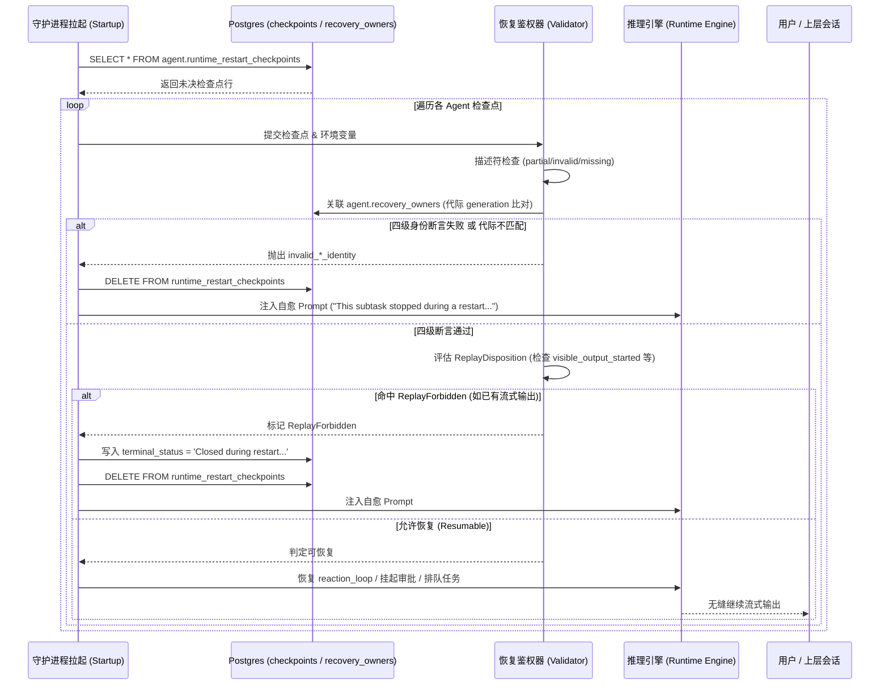

# 智能体中断恢复与持久化快照体系（课题 D · 协议层）

> 来源：`hatch` 核心引擎二进制（`/opt/hatch/bin/hatch`）符号表与内嵌 SQL、官方权威数据字典（`assets/muse-assets/skills/muse_db/references/schema.md`）
> 定位：**智能体高可用与故障恢复核心机制** —— 解析守护进程崩溃、重启或执行中断时的检查点持久化、所有权代际绑定、四级身份防御断言链与自愈提示词注入协议
> 系列：**COLLABORATION.md** · **COMMUNICATION.md** · [context-compaction-deep-dive.md](/content/batch1/context-compaction-deep-dive) · [browser-and-checkout.md 🔒](/roadmap#batch3) · [self-improvement-synthesis.md 🔒](/roadmap#batch4)
> 证据：Schema 逐字对齐；SQL 原文逐字；四级断言与状态枚举逐字；提示词模板逐字原文

---

## 0. 核心定位与为什么重要

在复杂长程任务中，智能体执行链路往往跨越数十个轮次，伴随着子智能体派发（Subagent Spawning）、外部 API 调用、Browser 沙箱操控以及人机协同审批（HITL Approval）。在此期间，主机宕机、守护进程重启、OOM 终止或租约超时不可避免。

对智能体运行时而言，故障恢复存在两个截然相反的极端陷阱：
1. **盲目重放（Blind Replay）**：若在重启后无脑重放未决任务，极易引发灾难性的外部副作用（例如重复扣划支付凭证、重复向第三方发送通知、或多次触发破坏性操作）。
2. **静默丢弃（Silent Dropping）**：若直接丢弃未完成的子任务，会导致复杂任务半途而废，上层协同者无法感知失败根因。

Muse 运行时通过在持久化层引入**代际绑定（Generation Fencing）**与**检查点机制（Restart Checkpoints）**，配合内存中的**四级身份防御断言链（The 4-tier Identity Assertion Chain）**、**重放抑制判决（Replay Disposition）**与**自愈提示词注入（Self-healing Prompt Injection）**，构建了一套兼顾幂等性、副作用防护与上下文自愈的工业级高可用体系。

---

## 1. 数据库设计与代际绑定拓扑（权威 Schema 交叉验证）

整个恢复架构由 `agent` 命名空间下的两张核心表与一张终态事件审计表共同支撑，全部字段均已与官方权威数据字典 ``assets/muse-assets/skills/muse_db/references/schema.md`` 逐字核验对齐。

### 1.1 所有权与代际父表：`agent.recovery_owners`

```sql
CREATE TABLE agent.recovery_owners (
  recovery_class   text NOT NULL,               -- 恢复分类标识（复合主键 1）
  owner_id         text NOT NULL,               -- 所有者标识（复合主键 2）
  generation       bigint NOT NULL DEFAULT 1,   -- 核心代际编号（代际栅栏核心）
  agent_id         text,                        -- 软引用 -> agent.agents.agent_id
  message_id       text,                        -- 软引用 -> runtime.messages.message_id
  active_at        timestamp with time zone NOT NULL DEFAULT now(),
  terminal_at      timestamp with time zone,    -- 终态时间戳（若不为空则表示该所有权已终结）
  terminal_status  text                         -- 终态状态文本
);

-- 约束：
-- PRIMARY KEY: (recovery_class, owner_id)
-- UNIQUE: (agent_id)
```

**拓扑特性**：`recovery_owners` 通过 `generation` 字段硬性绑定代际。每次所有权发生迁移、租约续期或实例重启，`generation` 必须严格递增。这保证了任何持有旧代际凭证的执行体无法在持久层篡改新代际的状态。

### 1.2 活跃恢复检查点：`agent.runtime_restart_checkpoints`

```sql
CREATE TABLE agent.runtime_restart_checkpoints (
  agent_id               text NOT NULL,         -- 主键（单键：每个 agent 仅持有当前唯一活跃检查点）
  mode                   text NOT NULL,         -- 恢复模式
  payload_json           text,                  -- 检查点状态序列化载荷（详见 §2）
  created_at             bigint NOT NULL,       -- 创建时间戳（毫秒）
  updated_at             bigint NOT NULL,       -- 刷新时间戳（毫秒）
  recovery_class         text,                  -- 软外键 -> recovery_owners.recovery_class
  recovery_owner_id      text,                  -- 软外键 -> recovery_owners.owner_id
  execution_config_json  text                   -- 恢复执行参数配置
);

-- 约束：
-- PRIMARY KEY: (agent_id)
```

### 1.3 终态事件审计：`agent.recovery_owner_terminal_events`

```sql
CREATE TABLE agent.recovery_owner_terminal_events (
  recovery_class  text NOT NULL,
  owner_id        text NOT NULL,
  generation      bigint NOT NULL,
  event_type      text NOT NULL,
  created_at      timestamp with time zone NOT NULL DEFAULT now(),
  payload_json    text
);

-- 约束：
-- PRIMARY KEY: (recovery_class, owner_id, generation, event_type)
```

---

## 2. 检查点 Payload 状态机模型（4 大 RuntimeRestart 结构）

二进制符号表反编译显示，`runtime_restart_checkpoints.payload_json` 并非无序文本，而是承载了执行引擎在特定阶段中断时的 4 大强类型状态结构：

```
hatch-engine/crates/hatch-agent/src/session/impl_session/message_execution/restart_state.rs
```

### 2.1 等待人工审批断点：`RuntimeRestartToolApprovalWait`
当智能体调用高危工具（如微交易支付、敏感连接器写入、外部调用）进入挂起等待用户卡片点击审批时，状态机持久化该结构：
- `wait_started_at_ms` / `timeout_remaining_ms`：记录等待起始与剩余超时预算。
- `authenticated_user_inputs`：捕获经过认证的用户原语。
- `dispatched_before_restart`：标记工具调用在崩溃前是否已被派发（防止重启后重复派发导致二次执行）。
- `producer_inference_request_id` / `producer_inference_attempt_id`：绑定上游推理请求。
- `presentation_locale` / `client_language_chain` / `client_ip` / `location_freshness`：保全交互现场的地理与多语言环境变量。

### 2.2 队列排队与输入断点：`RuntimeRestartQueuedSubmission`
当请求到达已被接纳但未开始执行推理时中断：
- `submission_key` / `absorbed_submission_keys`：记录已合并的排队输入键。
- `override_system_prompt` / `append_system_prompt`：保存动态提示词覆写。
- `requested_model` / `reasoning_strength_override`：保存模型版本与思考强度偏好。
- `tools_allowed_override` / `tool_call_prefill`：记录工具调用预填充与白名单。
- `transient_companion_wake_start_seq`：协同副智能体唤醒水位线。

### 2.3 反应循环断点：`RuntimeRestartReactionLoopState`
智能体在多步“思考-工具调用-返回”主循环中中断时的完整快照：
- `consecutive_batches`：已连续执行的批次计数。
- `pending_compact`：**与上下文压缩（课题 B）的直接衔接点**。若崩溃发生时刚好处于预压缩等待期，恢复后直接加载该标记。
- `pending_tool_calls`：已发出但尚未收到结果的未决工具调用。
- `completed_unpersisted_tool_outputs`：**极关键防重项**。已完成执行但尚未落库为 `context_items` 的工具返回，防止重启后重新调度。
- `lifetime_inference_count` / `lifetime_tool_call_count`：单会话生命周期调用配额计数器。

### 2.4 定时任务上下文：`RuntimeRestartScheduledWorkContext`
Cron 或后台周期作业中断时的快照：
- `job_id` / `attempt` / `version`：作业标识与重试轮次。
- `scheduled_work_context` / `replay_disposition`：调度执行现场与重放倾向。

---

## 3. 重启恢复断言集（Recovery Assertions & Identity Chain）

在系统重启或从检查点唤醒恢复时，恢复协调器遍历 `agent.runtime_restart_checkpoints` 执行准入核验。二进制符号表直接呈现了 7 个相互关联的恢复拦截错误标记（逐字原文提取）：

```
[符号表物理连排顺序（原始上下文）]
  1. partial_recovery_descriptor
  2. missing_conversation
  3. invalid_structural_owner_identity
  4. recovery_identity_mismatch
  5. invalid_recovery_descriptor         ← 夹在四级所有权判定中间
  6. invalid_durable_owner_identity
  7. invalid_inherited_execution_authority
```

> [!NOTE] 字符串表连排与控制流的辨析（审阅修正）
> 物理相邻的错误枚举通常映射至同一个 `enum RecoveryFailureReason`，但字符串在 `.rodata` 中的物理连排顺序并不等同于运行时的控制流判定顺序（控制流顺序为推断 ⚠️）。
> 语义上，这 7 个标记构成了一套紧密的“描述符完备性”与“多层身份防御”组合断言集：

```
[描述符与会话检查集合]
  ├── partial_recovery_descriptor      ← 检查点 JSON 解析残缺或缺少核心元数据
  ├── missing_conversation             ← 所属 conversation_id 在底层库中已被级联清理
  └── invalid_recovery_descriptor      ← 恢复描述符结构版本不兼容或内容非法

[身份与代际断言集合]
  ├── invalid_structural_owner_identity     ← 结构所有者身份失效（瞬态会话归属异常）
  ├── recovery_identity_mismatch            ← 恢复身份与当前主智能体身份不匹配
  ├── invalid_durable_owner_identity        ← 持久所有者身份失效（recovery_owners 校验失败）
  └── invalid_inherited_execution_authority ← 继承的执行权限失效（代际越界或降级）
```

### 3.1 身份断言详细语义

| 断言标识符（逐字原文） | 校验语义与防御目的 | 失败时的系统行为 |
|---|---|---|
| `invalid_structural_owner_identity` | **拓扑结构合法性**。检查该 Agent 在全局会话树（Session Tree）中的父子节点拓扑关系是否仍然有效，防止孤儿子节点或拓扑倒置。 | 拒绝恢复，标记结构损坏 |
| `recovery_identity_mismatch` | **所有者标识匹配**。校验 `checkpoints.recovery_owner_id` 与当前的执行者标识是否一致，防止执行权漂移。 | 阻断执行，防止跨租户冒领 |
| `invalid_durable_owner_identity` | **代际与持久生命周期**。核对 `recovery_owners` 中的 `generation` 是否仍然是最新代际，且 `terminal_at` 必须为 NULL。若旧进程持有的检查点被新代际覆盖，直接判定为过期。 | 强制作废，阻断陈旧进程重放 |
| `invalid_inherited_execution_authority` | **继承权限有效性**。校验子智能体从父级继承的工具授权（Capabilities/Grants/Leases）在重启后是否依然合法。若租约到期或权限凭证无法续签，则不得继承执行。 | 撤销执行权，触发降级自愈 |

---

## 4. 重放抑制与判决状态机（`RuntimeRestartCheckpointReplayDisposition`）

即使通过了四级身份断言，系统依然不会盲目从中断点重新执行。运行时通过枚举 `RuntimeRestartCheckpointReplayDisposition` 执行精确判决：

```
RuntimeRestartCheckpointReplayDisposition
├── Resumable (可安全恢复)
└── ReplayForbidden (严禁重放)
```

### 4.1 八大禁止重放判据（ReplayForbidden Reasons）

二进制中提取到的禁止重放理由严格遵循**“幂等第一、杜绝副作用、防幻觉双发”**原则：

1. **`visible_output_started`（核心铁律）**：
   若该智能体在崩溃前已经向用户端输出了流式文本（SSE/WebSocket 首字已发），**硬性禁止重放**。因为一旦重放，用户界面将观察到两条重复生成的消息，彻底破坏用户体验。
2. **`user_cancelled` / `user_cancelled_whole_stream`**：
   在中断期间用户已发送显式取消或清屏指令，重放无意义。
3. **`agent_closed`**：
   Agent 生命周期已被显式标记关闭。
4. **`model_switch`**：
   系统或用户在崩溃前后切换了底层模型（如 Llama 切换至 Avocado），由于不同模型的注意力机制与提示词规范不同，跨模型重放被严厉禁止。
5. **`context_reset`**：
   上下文已执行清空重置。
6. **`runtime_work_reap`**：
   该工作项因长时间无心跳已被后台收割器（Reaper）物理清理。
7. **`cron_exec_timeout`**：
   定时任务已超出预设的执行时间窗口，重放将破坏周期节拍。
8. **`successor_accepted`**：
   后继执行体或新会话已被客户端领养，旧任务自动作废。

---

## 5. 失败清理与自愈提示词注入协议（Self-healing Prompt Injection）

当任务由于身份断言失败、或属于 `ReplayForbidden`（如 `visible_output_started`）而无法重放时，Muse 不会抛出未处理异常，而是执行标准的**优雅降级与提示词自愈时序**：

### 5.1 状态持久化与快照删除 SQL

```sql
-- 1. 记录终态状态
UPDATE agent.recovery_owners
   SET terminal_at = now(), terminal_status = 'Closed during restart recovery without reporting a result.'
 WHERE recovery_class = $1 AND owner_id = $2;

-- 2. 清理陈旧的恢复检查点
DELETE FROM agent.runtime_restart_checkpoints
 WHERE agent_id = $1;
```

### 5.2 自愈引导提示词（逐字原文）

清理完成后，系统协调器将向负责接管的父智能体或主模型系统提示词中注入一条特殊的自愈引导通知：

> **重启恢复提示词模板（逐字原文）**：
> ```markdown
> This subtask stopped during a restart and did not report a result. Its work may be partly or fully done: check what it already produced before redoing anything, then redo or redelegate only what is actually missing.
> ```

**自愈哲学要点**：
- **拒绝盲目全量重做**：明文告诫主模型“其工作可能已部分或全部完成（partly or fully done）”。
- **强制先查已有工件**：要求模型首先使用 `read` / `list` 等工具检查沙箱中已经写出的产物（`check what it already produced before redoing anything`）。
- **精准最小化补齐**：仅重做或重新委派确属缺失的部分（`redo or redelegate only what is actually missing`），将故障带来的算力损耗与重复开销降至最低。

---

## 6. 运行时恢复全时序流（Mermaid 状态转移）



---

## 7. 与上层业务及 Browser 隔离（课题 C）的横向对照

将本协议与课题 C（[`browser-and-checkout.md` 🔒](/roadmap#batch3)）及课题 B（[`context-compaction-deep-dive.md`](/content/batch1/context-compaction-deep-dive)）对照，体现出高度统一的工程设计风格：

| 机制维度 | Agent 级恢复（本篇）| Browser 隔离级恢复（课题 C）| 上下文压缩级恢复（课题 B）|
|---|---|---|---|
| **核心防护对象** | Agent 执行流与未决工具输出 | 真实无头 Chrome 页面与会话 | 会话历史投影视图与未决 Todo |
| **代际控制** | `recovery_owners.generation` | `direct_http_observer_chrome_generation` | `history_rewrite_generation` |
| **租约 / 所有权** | `recovery_class` + `owner_id` | `BrowserLease` + `browser_persona` | `checkpoint_seq` + 水位线双重过滤 |
| **恢复入口** | `runtime_restart_checkpoints` | `OpenTaskRecovery` / `browser_open_task_recovery_enabled` | `agent_compactions` + `details_json` |
| **防重判据** | `visible_output_started` | `mutation_watermark` / 幂等键 | `GREATEST(prompt_floor, checkpoint_seq)` |
| **故障应对** | 注入 Prompt 提示“仅重做缺失部分” | 人工接管 `needs_user_runway` 或释放租约 | 丢弃陈旧工件，降级前台重算 |

---

## 8. 未解明与边界标注

| # | 未解明项 | 现状与证据边界 |
|---|---|---|
| 1 | `RuntimeRestartCheckpoint` 的定时落盘频率 | 确认在工具调用、审批挂起与排队合并时触发落盘；但对于纯 LLM 推理长流（如数千字输出），是否周期性定时写入中间断点尚未确证 |
| 2 | `execution_config_json` 的全量枚举模式 | 二进制中提取为泛型 JSON，其随不同的 `mode`（如 root vs subagent）携带的全部参数分支待全量梳理 |
| 3 | 崩溃收割器（Reaper）的具体扫描周期 | 确认存在 `runtime_work_reap` 动作，但后台轮询清理僵尸检查点的 Cron 间隔在容器外部未见显式声明 |

---

*本报告基于 `/opt/hatch/bin/hatch` 二进制符号表、运行时内嵌 SQL 及官方权威数据字典提取，代码路径与字段逐字核准。*
